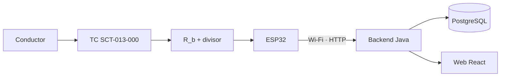

# Monitor de consumo eléctrico no invasivo

Sistema para medir la **corriente eficaz (I_rms)** de una carga eléctrica sin cortar el cable, usando un transformador de corriente de núcleo partido **SCT-013-000** y un **ESP32**. Las lecturas se envían por Wi-Fi a un **backend en Java**, que guarda el histórico, y una **web en React** muestra los valores actuales, el histórico y las gráficas.

Proyecto académico de electromagnetismo aplicado.

## Arquitectura



Detalle en [docs/arquitectura.md](docs/arquitectura.md).

## Supuestos declarados

- **Potencia y energía son estimaciones:** `P_est = V_ref · I_rms`, con `V_ref = 220 V` y factor de potencia = 1. No se mide la tensión ni el desfase.
- **No identifica equipos** (no es NILM): la carga la declara el usuario al iniciar una sesión.
- Se mide **una carga por sesión**.

## Estructura

```
firmware/     ESP32 · PlatformIO · Arduino (C++)
simulation/   Proyecto Wokwi con chip personalizado que simula el TC
backend/      Java 21 · Spring Boot 3 · Maven
frontend/     React · Vite · TypeScript
docs/         Arquitectura, API, calibración, pruebas
```

## Cómo levantar cada parte

### Base de datos

```bash
cp .env.example .env   # ajusta las credenciales
docker compose up -d db
```

### Backend

Requiere Java 21 y Maven (o Docker). Con la base de datos arriba:

```bash
cd backend
export DB_URL=jdbc:postgresql://localhost:5432/monitor_energia DB_USER=monitor DB_PASSWORD=<tu-clave>
mvn spring-boot:run          # http://localhost:8080/swagger-ui.html
mvn verify                   # pruebas (usan H2, no necesitan la base)
```

Sin Java instalado, las pruebas se pueden ejecutar con Docker:
`docker run --rm -v "$PWD":/app -w /app maven:3.9-eclipse-temurin-21 mvn verify`.

Variables: `DB_URL`, `DB_USER`, `DB_PASSWORD`, `SERVER_PORT`, `CORS_ORIGINS`. Referencia de la API en [docs/api.md](docs/api.md).

### Firmware

Requiere [PlatformIO](https://platformio.org/install/cli) (`pip install platformio`).

```bash
cd firmware
cp include/secrets.example.h include/secrets.h   # Wi-Fi, URL del backend, DEVICE_ID y API key
pio run -e esp32dev -t upload && pio device monitor
pio test -e native                               # pruebas del cálculo de Irms en el PC
```

| Entorno | Uso |
|---|---|
| `esp32dev` | Placa real |
| `wokwi` | Simulación (`-DSIMULACION`, red `Wokwi-GUEST`) |
| `wokwi-software` | Simulación, plan B (muestras por software) |
| `native` | Pruebas unitarias en el PC |

- Parámetros (pin ADC, `R_b`, `N_s`, `K_cal`, `I_MIN`, intervalos, búfer) en `firmware/include/config.h`.
- Cada segundo mide una ventana de 200 ms (12 ciclos de 60 Hz); cada 5 s envía el RMS de esas ventanas.
- Las lecturas no confirmadas por el backend quedan en un búfer (1 h) y se reintentan con backoff.
- El monitor serial imprime `Irms=0.452 A  P_est=99.4 W` (P_est solo informativa; la calcula el backend).
- La secuencia se reserva en bloques de 12 en la flash: un reinicio deja como máximo ese hueco.

### Simulación (Wokwi)

Un chip personalizado (`simulation/chips/ct-sim`) simula la salida del SCT-013-000 en GPIO34, con la `I_rms` ajustable en vivo.

```bash
cd firmware && pio run -e wokwi
cd ../simulation && ./chips/build.sh     # compila el chip a wasm (Docker)
```

Luego abre `simulation/diagram.json` con la extensión Wokwi de VS Code. Pasos para wokwi.com, conexión al backend (túnel) y plan B en [docs/simulacion.md](docs/simulacion.md).

### Frontend

_Disponible en la Fase 4._

## Seguridad

- El sensor se coloca en **un solo conductor** de un **cable separador de línea**, armado y revisado por un técnico o el laboratorio.
- **Nunca** dejes el secundario del SCT-013-000 abierto mientras circula corriente por el primario.
- Prueba con cargas resistivas (focos incandescentes, hervidor, plancha).
- No trabajes con la instalación energizada si no tienes la formación adecuada.

## Licencia

[MIT](LICENSE)
