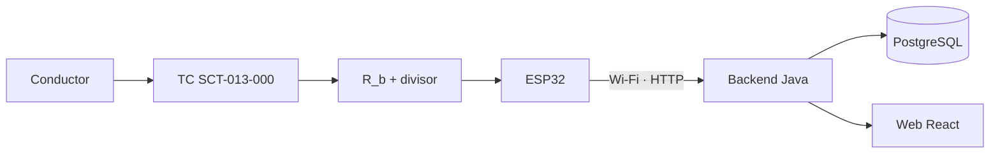

# Monitor de consumo eléctrico no invasivo

Sistema para medir la **corriente eficaz (I_rms)** de una carga eléctrica sin cortar el cable, usando un transformador de corriente de núcleo partido **SCT-013-000** y un **ESP32**. Las lecturas se envían por Wi-Fi a un **backend en Java**, que guarda el histórico, y una **web en React** muestra los valores actuales, el histórico y las gráficas.

Proyecto académico de electromagnetismo aplicado.

## Arquitectura



Detalle en [docs/arquitectura.md](docs/arquitectura.md).

## Supuestos declarados

- **Potencia y energía son estimaciones:** `P_est = V_ref · I_rms`, con `V_ref = 220 V` y factor de potencia = 1. No se mide la tensión ni el desfase.
- **No identifica equipos** (no es NILM): la carga la declara el usuario al iniciar una sesión.
- Se mide **una carga por sesión**.

## Estructura

```
firmware/     ESP32 · PlatformIO · Arduino (C++)
simulation/   Proyecto Wokwi con chip personalizado que simula el TC
backend/      Java 21 · Spring Boot 3 · Maven
frontend/     React · Vite · TypeScript
docs/         Arquitectura, API, calibración, pruebas
```

## Cómo levantar cada parte

### Base de datos

```bash
cp .env.example .env   # ajusta las credenciales
docker compose up -d db
```

### Backend

_Disponible en la Fase 1._

### Firmware

_Disponible en la Fase 2._

### Simulación (Wokwi)

_Disponible en la Fase 3._

### Frontend

_Disponible en la Fase 4._

## Seguridad

- El sensor se coloca en **un solo conductor** de un **cable separador de línea**, armado y revisado por un técnico o el laboratorio.
- **Nunca** dejes el secundario del SCT-013-000 abierto mientras circula corriente por el primario.
- Prueba con cargas resistivas (focos incandescentes, hervidor, plancha).
- No trabajes con la instalación energizada si no tienes la formación adecuada.

## Licencia

[MIT](LICENSE)
