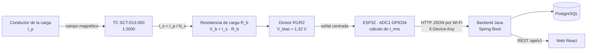

# Arquitectura

## Flujo de la señal y de los datos

## 1. Captación (física)

Un **transformador de corriente de núcleo partido SCT-013-000** (100 A : 50 mA) abraza **un solo conductor** de la carga. La corriente alterna del primario crea un flujo magnético variable en el núcleo; por la **ley de Faraday** se induce una corriente en el secundario:

- `I_s = I_p / N_s`, con `N_s = 2000`.

Si se abrazan los dos conductores (fase y neutro), sus campos se cancelan y la lectura es casi cero.

## 2. Acondicionamiento

| Etapa | Fórmula | Valor por defecto |
|---|---|---|
| Resistencia de carga | `V_b = I_s · R_b` | `R_b = 47 Ω` |
| Divisor de polarización | `V_bias = V_cc · R2 / (R1 + R2)` | `R1 = 15 kΩ`, `R2 = 10 kΩ`, `V_cc = 3,3 V` → `≈ 1,32 V` |

El divisor desplaza la señal alterna para que quede dentro del rango confiable del ADC del ESP32 con atenuación de 11 dB (**≈ 150 mV a 2450 mV**). Todos los valores son configurables porque se recalibrarán con el hardware real.

## 3. Medición en el ESP32

- Se usa solo **ADC1 (GPIO32–39)**, porque ADC2 no funciona con Wi-Fi activo. Pin por defecto: **GPIO34**.
- Se muestrea una ventana de **≥ 10 ciclos de 60 Hz** (≈ 200 ms).
- El offset se calcula como el promedio de la ventana y se resta.
- `I_rms = sqrt( (1/n) · Σ i_k² )`, con `i_k = (v_k / R_b) · N_s · K_cal`.
- Por debajo de un umbral de ruido (`I_MIN`) se reporta 0.

## 4. Envío y almacenamiento

- El ESP32 envía lotes de lecturas cada `INTERVALO_ENVIO_S` (5 s por defecto) a `POST /api/v1/lecturas`, con un número de `secuencia` para detectar pérdidas.
- Las lecturas no enviadas quedan en un búfer y se reintentan.
- El **backend calcula** la potencia y la energía (no confía en el firmware):
  - `P_est = V_ref · I_rms` (`V_ref = 220 V`, FP = 1)
  - `E_est = Σ (P_est · Δt_h) / 1000` (kWh)

## 5. Visualización

La web en React muestra la sesión en vivo, el histórico, comparaciones entre sesiones y la validación contra una pinza amperimétrica. Distingue lo **medido** (`I_rms`) de lo **estimado** (`P_est`, `E_est`).

## Supuestos

- Potencia y energía son **estimaciones**: no se mide la tensión ni el desfase.
- El sistema **no identifica equipos** (no es NILM): el usuario declara la carga al iniciar una sesión.
- Se mide **una carga por sesión**.
